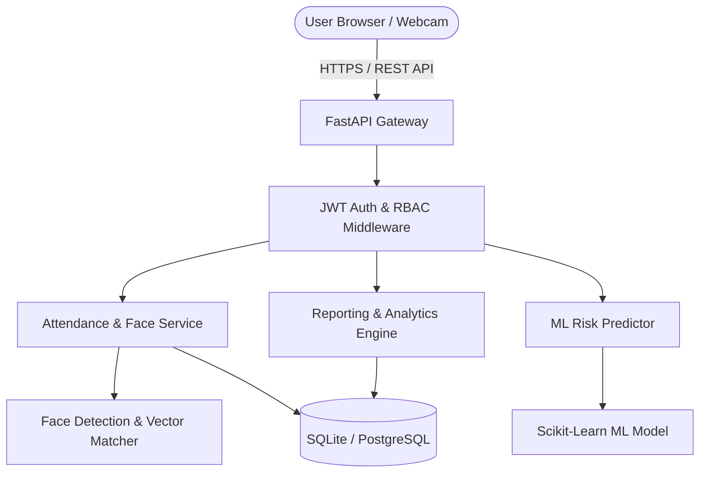
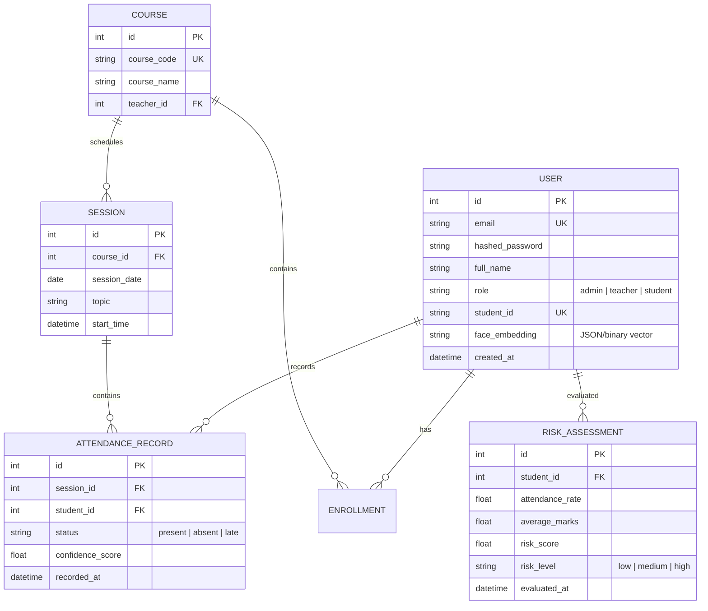

# Architecture Specification
## SmartCampus AI: System Design & Technical Contracts

### 1. High-Level Architecture
SmartCampus AI follows a modular, decoupled architecture:
- **Presentation Tier**: React 18 SPA (Vite) + Tailwind CSS + Lucide Icons + Recharts.
- **Application Tier**: FastAPI (Python 3.11) asynchronous RESTful API with Pydantic v2 data validation and dependency injection.
- **AI/ML Engine**:
  - Face Biometrics: OpenCV + vector cosine matcher against stored gallery embeddings.
  - Risk Predictor: scikit-learn pipeline (StandardScaler + Logistic Regression / Random Forest).
- **Persistence Tier**: SQLite for rapid local development; structured via SQLAlchemy ORM for seamless zero-code migration to PostgreSQL.



---

### 2. Database Schema (Entities & Relationships)



---

### 3. API Contract Specifications

| Method | Endpoint | Description | Request Body | Response (200 OK) | Error Codes |
|---|---|---|---|---|---|
| `POST` | `/api/v1/auth/login` | Authenticate user & issue JWT | `{username, password}` | `{access_token, token_type, role, user}` | 401 Unauthorized |
| `POST` | `/api/v1/attendance/verify-face` | Match webcam frame to student | `{session_id, image_base64}` | `{matched: bool, student_id, student_name, confidence}` | 400 Bad Frame, 404 No Match |
| `POST` | `/api/v1/attendance/mark` | Batch commit attendance | `{session_id, records: [{student_id, status}]}` | `{committed: int, session_id}` | 403 Forbidden |
| `GET` | `/api/v1/attendance/reports/csv` | Export session attendance | Query: `course_id, start_date, end_date` | `text/csv` stream attachment | 404 No Data |
| `GET` | `/api/v1/analytics/risk-summary` | Overview of at-risk students | Query: `course_id` | `{total_students, high_risk: int, medium_risk: int, students: [...]}` | 401, 403 |
| `POST` | `/api/v1/predictor/evaluate` | Run inference on student metrics | `{attendance_pct, cia_score, assignment_pct, backlogs}` | `{risk_level, probability, recommendations: [...]}` | 422 Validation Error |

---

### 4. Machine Learning & Biometrics Pipeline Contract
- **Face Embedding Extraction**:
  - Input: Normalized RGB frame (640x480).
  - Normalization: Face aligned, resized to 112x112, luminance standardized.
  - Cosine Distance Threshold: $D_{cos} \le 0.45$ classifies as authentic match.
- **Risk Prediction Pipeline**:
  - Features: `[attendance_percentage, midterm_score, assignment_completion, participation_index]`.
  - Artifact: `models/risk_predictor.joblib` trained with standard train/validation split.
  - Evaluation protocol: Precision, Recall, and ROC-AUC reported in `TEST_REPORT.md`.

---

### 5. Repository File Structure
```
smartcampus-ai/
├── backend/
│   ├── app/
│   │   ├── api/v1/endpoints/
│   │   │   ├── auth.py
│   │   │   ├── attendance.py
│   │   │   ├── students.py
│   │   │   └── predictor.py
│   │   ├── core/ (config, security, database)
│   │   ├── models/ (SQLAlchemy models)
│   │   ├── schemas/ (Pydantic schemas)
│   │   ├── services/ (face_service.py, ml_service.py)
│   │   └── main.py
│   ├── tests/
│   └── requirements.txt
├── frontend/
│   ├── src/
│   │   ├── components/ (AttendanceCam, RiskCard, StatBadge)
│   │   ├── pages/ (Dashboard, Attendance, StudentRoster, Reports)
│   │   ├── services/ (api.js, auth.js)
│   │   └── App.jsx
│   ├── package.json
│   └── vite.config.js
├── docker-compose.yml
└── Dockerfile
```
